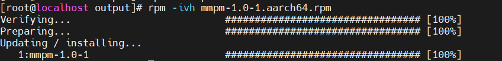

# Installation Guide<a name="EN-US_TOPIC_0000002553346771"></a>

## Environment Requirements<a name="EN-US_TOPIC_0000002522226848"></a>

To use KDADK-MMPM smoothly and securely, ensure that your environment is one of the verified environments. If you encounter any problem when using this feature, check that your environment is a verified environment.

**Table  1**  Verified environments

|OS|CPU|GCC Version|
|--|--|--|
|openEuler 22.03 LTS SP4|New Kunpeng 920 processor model|10.3.1|
|openEuler 24.03 LTS SP1|New Kunpeng 920 processor model|12.3.1|


**Table  2**  Software requirement

|Software|Version|How to Obtain|
|--|--|--|
|Boostkit-boostida-kdadk-mmpm-2.5.3.zip|2.5.3|Obtain the software package from the **Smart Data Analysis > Resource Download** page.|


To use KDADK-MMPM smoothly and securely, ensure that your environment is one of the verified environments. If you encounter any problem when using this feature, check that your environment is a verified environment.
## Software Deployment<a name="EN-US_TOPIC_0000002553186817"></a>

**Obtaining the Software Package and Verifying Its Integrity<a name="section5964123113114"></a>**

1. Obtain the software package and its SHA-256 checksum file from the Kunpeng community.

    Obtain the  **Boostkit-boostida-kdadk-mmpm-2.5.3.zip**  software package as instructed in  [Table 2](environment-requirements.md#table95981444171712). 

    > **NOTE:** 
    >Before using the software package, read and agree to  [Kunpeng BoostKit User License Agreement 2.0](https://www.hikunpeng.com/en/legal/developer/boostkit/software/protocol).

2. Calculate the SHA-256 checksum of the software package.

    Run the following command on Linux:

    ```sh
    sha256sum Boostkit-boostida-kdadk-mmpm-2.5.3.zip
    ```

    Run the following command on Windows:

    ```sh
    certutil -hashfile Boostkit-boostida-kdadk-mmpm-2.5.3.zip SHA256
    ```

3. Compare the calculated checksum with the value recorded in the SHA-256 checksum file. If the values match, the software package is intact. If they do not match, obtain the software package again.

**Installing the Software Package<a name="section3965331101111"></a>**

KDADK-MMPM is a multi-pattern rule matching software package, which accelerates matching of massive-scale fixed-length rules or matching of hundreds of thousands of variable-length rules.

1. Obtain the KDADK-MMPM software package  **Boostkit-boostida-kdadk-mmpm-2.5.3.zip**  as instructed in  [Table 2](environment-requirements.md#table95981444171712).
2. Decompress  **Boostkit-boostida-kdadk-mmpm-2.5.3.zip**  to obtain the KDADK-MMPM binary RPM package.
3. Install KDADK-MMPM.

    ```
    rpm -ivh mmpm-xxxx.aarch64.rpm
    ```

    

    After the installation is complete, the dynamic library is installed to  **/usr/local/lib**, and the header file of the public function API is saved to  **/usr/local/include**.

    > **NOTE:** 
    >In the preceding command,  _xxxx_  indicates the version.

4. Enable KDADK-MMPM.

    When using KDADK-MMPM, you need to include the  **mmpm.h**  header file in the program and call the KDADK-MMPM-related functions. For example, with GCC, you can link the library by adding  **-lmmpm**  in the compilation and linking command. For details, see the example in  [API Usage Example](en-us_topic_0000002553346765.md).

    ```
    gcc your_program.c -o your_program -lmmpm
    ```

    Successful compilation and normal execution of your program indicate that KDADK-MMPM has been successfully enabled.
